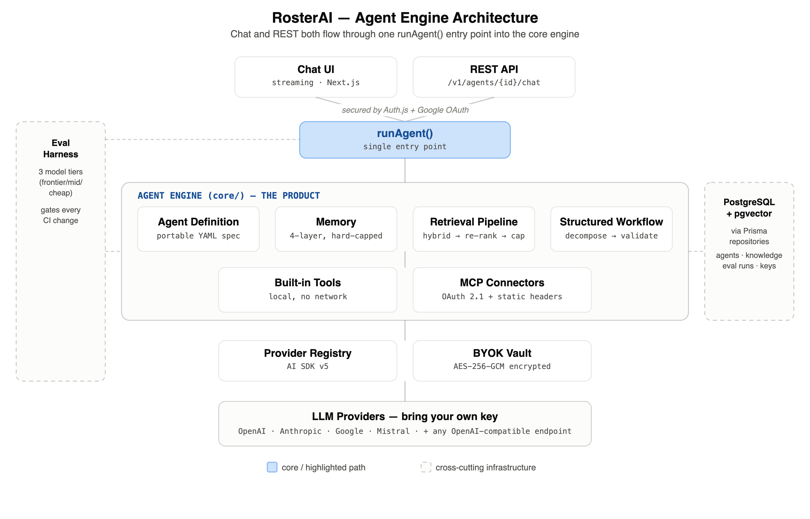

# Roster

**Hireable AI employees that work like domain experts on _any_ LLM you bring.**

[](LICENSE)

Roster is an open-source platform of specialized AI agents — Customer Support, Content
Writer, Research Analyst, Financial Analyst and Team Organizer. You connect your own
provider key (BYOK), pick an employee, and work through chat or a REST API.

The model is a commodity; the scaffolding around it is the product. Most agent failures
are _context_ failures, not model failures, so Roster invests in the environment instead
of chasing the "best" model — which is what lets cheap and open-weight models perform
close to frontier ones.



## What makes it different

- **Any LLM, ~15+ providers.** OpenAI, Anthropic, Google, Mistral, Groq, DeepSeek, Together,
  Fireworks, Bedrock, Azure, Vertex, OpenRouter, Ollama, and any OpenAI-compatible
  endpoint. Keys are AES-256-GCM encrypted and never logged.
- **Expertise as data.** Each employee is a portable YAML definition plus procedural
  _playbooks_ (how an expert decides), not just knowledge. See [docs/agent-spec.md](docs/agent-spec.md).
- **Disciplined context.** Hybrid retrieval (vector + full-text) → LLM re-rank → top 3–5 →
  hard token cap. Less context, not more. Permission-scoped at the SQL level.
- **Structured workflow.** Decompose → execute → validate → retry/rollback, with a
  single-step bypass for trivial turns and capped retries.
- **Tools via MCP.** Local built-in tools plus MCP connectors (OAuth 2.1 + PKCE, or static
  headers) from a curated directory or your own server URL.
- **Evals as the gate.** A harness runs every change across frontier/mid/cheap tiers.
- **Chat + REST.** One `runAgent()` powers both the streaming UI and `POST /api/v1/agents/{id}/chat`.

## Quick start

Prerequisites: Node 22+, Docker.

```bash
git clone https://github.com/habeebmoosa/roster.git && cd roster
npm install
cp .env.example .env     # fill in AUTH_SECRET, ENCRYPTION_KEY and one sign-in provider
npm run db:up            # Postgres 16 + pgvector (host port 5434)
npm run db:migrate
npm run db:seed          # the five employees + connector directory
npm run dev
```

Open http://localhost:3005 (health check: `/api/health`), sign in, add a provider key,
hire an employee and chat.

**Prefer one command?** `docker compose up --build` runs the whole stack — see
[docs/self-hosting.md](docs/self-hosting.md), which also covers Vercel + Supabase.

## Tech stack

Next.js 15 (App Router) · TypeScript (strict) · Vercel AI SDK · PostgreSQL + pgvector ·
Prisma · Auth.js (Google or GitHub) · Tailwind CSS v4 · Zod · Vitest + Playwright.

## Project structure

```
src/
  app/        Next.js routes (delivery layer only)
  core/       the agent engine — framework-agnostic
  server/     server-only: db repositories, auth, crypto, rate limiting, services
  ui/         hand-rolled Tailwind design system
  features/   self-contained UI domain modules
agents/       agent definitions — the portable spec
mcp-servers/  curated MCP connector directory
evals/        labeled eval sets
prisma/       schema + migrations (incl. custom pgvector migration)
docs/         design docs, agent spec, self-hosting
```

`core/` never imports from `app/` or Next.js.

## Scripts

| Script                                     | What it does                               |
| ------------------------------------------ | ------------------------------------------ |
| `npm run dev`                              | Start the dev server                       |
| `npm run build` / `npm run start`          | Production build / serve                   |
| `npm run lint` / `npm run typecheck`       | ESLint / `tsc --noEmit`                    |
| `npm run test`                             | Unit tests (Vitest)                        |
| `npm run test:integration`                 | Integration tests — needs a live DB        |
| `npm run test:e2e`                         | Playwright e2e — run `npm run build` first |
| `npm run db:up` / `npm run db:down`        | Start / stop the local Docker Postgres     |
| `npm run db:migrate` / `npm run db:deploy` | Prisma migrate (dev / deploy)              |
| `npm run ingest -- --agent <id>`           | Chunk + embed an employee's knowledge      |
| `npm run eval` / `npm run eval:gate`       | Run evals across model tiers / CI gate     |

## Docs

- [Product overview](docs/Product-Overview.md) · [Design & build plan](docs/MVP-Plan.md)
- [Agent definition spec](docs/agent-spec.md) · [Self-hosting](docs/self-hosting.md)
- [Contributing](CONTRIBUTING.md) · [Security](SECURITY.md) · [Code of Conduct](CODE_OF_CONDUCT.md)

## Status

Pre-1.0. The MVP is complete (BYOK, engine, retrieval, workflow, tools, chat, REST API).
One claim is not yet independently verified: live cross-tier eval results (cheap model
close to frontier). The harness is in place — run `npm run eval` with your own keys and
please share results.

## License

[Apache-2.0](LICENSE). Provider and connector logos belong to their owners; see [NOTICE](NOTICE).
